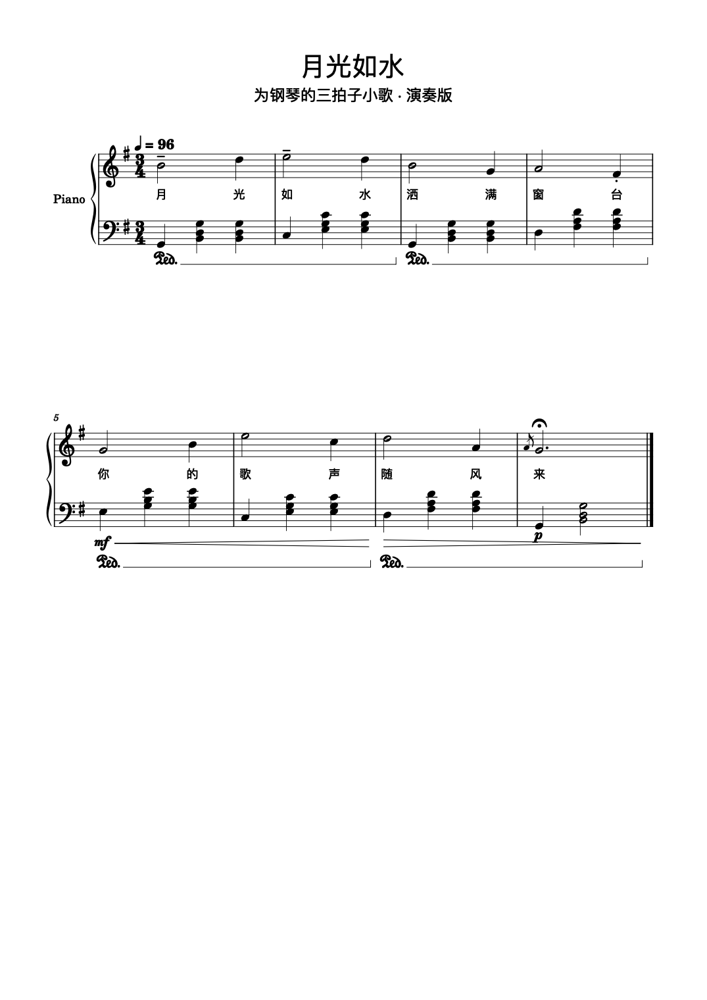

# EasyMuseMCP

**用一句话（或一次工具调用）直接写出真正的 MuseScore 乐谱。**

EasyMuseMCP 把「紧凑的文本记谱」编译成 MusicXML，再驱动 MuseScore 的命令行（无窗口）导出 `.mscz / .pdf / .png / .svg / .midi / .mp3`。它同时提供两个入口：

- **CLI（`msc`）** —— 人和脚本都能用
- **MCP server** —— 让 Claude / Cursor / DSH 等 AI 客户端把它当成内置工具调用

不需要打开 MuseScore 窗口，不需要装 QML 插件，不需要 WebSocket。纯 Node.js，零第三方依赖。



---

## 目录

- [为什么做这个](#为什么做这个)
- [工作原理](#工作原理)
- [环境要求](#环境要求)
- [安装](#安装)
- [快速开始（CLI）](#快速开始cli)
- [接入 MCP 客户端](#接入-mcp-客户端)
- [MCP 工具清单](#mcp-工具清单)
- [记谱语法](#记谱语法)
- [编辑已有乐谱](#编辑已有乐谱)
- [CLI 全部命令](#cli-全部命令)
- [实现要点（踩过的坑）](#实现要点踩过的坑)
- [已知限制](#已知限制)
- [项目结构](#项目结构)
- [开发与测试](#开发与测试)
- [许可](#许可)

---

## 为什么做这个

社区里已有的 MuseScore MCP（比如 `mcp-musescore` 一类）基本都走 **GUI + QML 插件 + WebSocket** 路线：必须让 MuseScore 窗口开着、手动进 Plugins 启用插件、靠移动光标一个个敲音符。

这条路子的问题很明显：不能批量、不能无人值守、出错就卡在光标位置、也没法在服务器上跑。

EasyMuseMCP 换了个底层：**MuseScore 自带的无窗口转换模式**才是一台真正的「渲染引擎」——你只要把 MusicXML 交给它，它就能排出一份正经乐谱。于是问题变成「怎么把人类/模型想写的音乐，可靠地变成 MusicXML」，剩下的都交给 MuseScore。

实测：单页钢琴谱从文本到 PDF/PNG/MIDI/MP3 约 2–6 秒。

---

## 工作原理

```
文本 DSL ──解析──> 乐谱模型 ──生成──> MusicXML ──MuseScore CLI──> mscz / pdf / png / midi / mp3
                      │                    ▲
                      ├─ 小节时值校验       │
                      ├─ 连音线/歌词/反复    └── 编辑层：改标题、速度、调号、移调、增删小节、加歌词
                      └─ 演奏法/装饰音/踏板
```

关键设计：

| 模块 | 作用 |
|---|---|
| `lib/dsl.js` | 解析文本记谱，做**小节时值校验**（不够补休止、超了报错并给出小节号） |
| `lib/musicxml.js` | 生成 MusicXML 4.0，处理调号、连音线、歌词、反复、装饰音、踏板、版面 |
| `lib/mscore.js` | 封装 MuseScore CLI：定位程序、导出、抽 JSON、收集产物 |
| `lib/edit.js` | 在 MusicXML 上做小节/元素级编辑，用于改**已有**乐谱 |
| `lib/transpose.js` | 纯文本移调，对任意 MuseScore 可读格式生效 |
| `server.js` | 零依赖 stdio MCP server（手写 JSON-RPC） |

---

## 环境要求

| 依赖 | 版本 | 说明 |
|---|---|---|
| Node.js | ≥ 18 | 用到了 ESM 与 `node:` 内置模块 |
| MuseScore | 3.x / 4.x | 提供无窗口渲染，**必须安装**（推荐 MuseScore 4） |

MuseScore 会被自动探测，常见路径：

- macOS：`/Applications/MuseScore 4.app/Contents/MacOS/mscore`
- Linux：`/usr/bin/mscore`、`/usr/local/bin/mscore`
- Windows：请把 `MSCORE_BIN` 设为 `MuseScore4.exe` 的完整路径

```bash
# 自检
node bin/msc.js doctor
# MuseScore binary : /Applications/MuseScore 4.app/Contents/MacOS/mscore
# version          : 4.7.4
# status           : ready
```

自定义路径：`export MSCORE_BIN=/path/to/mscore`

---

## 安装

```bash
git clone https://github.com/Ranger013/EasyMuseMCP.git
cd EasyMuseMCP
node bin/msc.js doctor
```

想全局使用 `msc` 命令：

```bash
npm link          # 之后可以直接敲 msc
```

或直接从仓库跑（无需安装）：

```bash
npx github:Ranger013/EasyMuseMCP doctor
```

---

## 快速开始（CLI）

写一个 `song.msc`：

```text
title: 小星星
composer: 法国民谣
key: C
time: 4/4
tempo: 100

part "Piano" instrument=piano staves=2 clefs=treble,bass
voices 1
C5/4 C5/4 G5/4 G5/4 | A5/4 A5/4 G5/2 |
voices 2
C3/2 C3/2 | F2/2 C3/2 |
```

一条命令出全套：

```bash
node bin/msc.js compose song.msc --formats pdf,png,mscz,midi,mp3 --out out/song
```

```
✔ 小星星 — 2 measures, 12 notes, 1 part(s)
  musicxml out/song/song.musicxml
  mscz     out/song/song.mscz
  pdf      out/song/song.pdf
  png      out/song/song-1.png
  midi     out/song/song.midi
  mp3      out/song/song.mp3
```

其它常用命令：

```bash
msc ref                        # 打印完整记谱语法
msc inspect out/song/song.mscz  # 读标题/调号/拍号/速度/声部/页数/时长
msc transpose song.mscz --semitones -2
msc parts song.mscz            # 按声部导出分谱
msc open song.mscz             # 在 MuseScore 里打开继续手改
```

---

## 接入 MCP 客户端

server 走 **stdio**，所以配置里给一个启动命令即可。

**Claude Desktop / Claude Code / Cursor 等（JSON）**

```json
{
  "mcpServers": {
    "easymuse": {
      "command": "node",
      "args": ["/绝对路径/EasyMuseMCP/server.js"]
    }
  }
}
```

**DSH（`~/.dsh/profiles/<profile>/cordis.patch.yml`）**

```yaml
- insert:
    - name: "@deepseek-ai/dsh-mcp-client"
      config:
        transport: stdio
        serverName: musescore          # 工具前缀 → mcp__musescore__*
        command: /usr/local/bin/node
        args: ["/绝对路径/EasyMuseMCP/server.js"]
        toolCallTimeoutMs: 180000
        failOnStartupError: false
```

接入后模型会先调 `musescore_notation_reference` 读语法，然后用 `musescore_compose` 写谱、用 `musescore_view` 把渲染结果**当图片看**回来，自己检查排版。

---

## MCP 工具清单

共 11 个工具：

| 工具 | 用途 |
|---|---|
| `musescore_doctor` | 检查 MuseScore 是否可用、版本号 |
| `musescore_notation_reference` | 返回记谱语法速查表（模型先读这个） |
| `musescore_compose` | 文本 → 乐谱，返回产物路径 + 音乐摘要 + 警告 |
| `musescore_render` | 任意乐谱转格式 / 单页导出 / 套用 `.mss` 样式 |
| `musescore_view` | 渲染某页并**以图片返回**，用于自查排版 |
| `musescore_inspect` | 读取元数据 |
| `musescore_transpose` | 整谱移调 |
| `musescore_extract_parts` | 按声部导出分谱 |
| `musescore_edit` | 按操作列表修改已有乐谱（见下） |
| `musescore_join` | 多份乐谱首尾相接 |
| `musescore_open` | 在 MuseScore GUI 中打开 |

---

## 记谱语法

完整版：`msc ref`。下面是最常用的部分。

```text
title: 欢乐颂            subtitle: Ode to Joy
composer: 贝多芬         key: G          time: 4/4        tempo: 120
systems: 4               page: A4        margins: 15      scaling: 7

part "Piano" instrument=piano staves=2 clefs=treble,bass
voices 1
|: E4/4 E4/4 F4/4 G4/4 | G4/4 F4/4 E4/4 D4/4 :|
voices 2
%ped [C3 E3 G3]/1 | %ped-up [G2 B2 D3]/1 |
```

| 写法 | 含义 |
|---|---|
| `C5/4` | 音名+八度 `/` 时值（4=四分，2=二分，1=全音符，8=八分，16=十六分） |
| `F#4/8` `Bb3/2` `Cn4/4` | 升 / 降 / 还原 |
| `C5/4.` `C5/4..` | 附点 / 双附点 |
| `[C4 E4 G4]/4` | 和弦（空格或逗号分隔） |
| `r/4`、`R` | 休止符 / 整小节休止 |
| `C5/2~ C5/2` | 连音线（自动配对，可跨小节） |
| `(C5/4 D5/4)` | 圆滑线 |
| `T3{ C5/8 D5/8 E5/8 }` | 三连音（也支持 T5 / T7） |
| `gD5/16` | 倚音；`g[C5 E5]/16` 倚音和弦 |
| `C5/4%stacc,accent` | 演奏法：stacc / staccissimo / accent / tenuto / marcato / breath / upbow / downbow |
| `F#5/2%trill` | 装饰音：trill / mordent / inv-mordent / turn / inv-turn / tremolo |
| `G4/1%fermata` | 延长记号 |
| `C5/4!mf` | 力度：pp p mp mf f ff sf fp |
| `C5/4"一"` | 歌词（词尾 `-` 表示同词未完） |
| `%ped` `%ped-up` `%ped-change` | 延音踏板 |
| `%cresc` `%dim` `%wedge-stop` | 渐强 / 渐弱发夹 |
| `@time=3/4` `@key=Eb` `@tempo=120` | 中途变拍号 / 变调 / 变速 |
| `\|` `\|\|` `\|]` `\|:` `:\|` | 小节线 / 终止线 / 反复记号 |

版面指令：`page`（A4/A5/A3/letter/`210x297`）、`margins`（毫米，1/2/4 个数字）、`scaling`（每谱间毫米数，调大即整体放大）、`staff-distance`、`system-distance`、`systems`（每行小节数）、`style`（复用 MuseScore 导出的 `.mss`）。

> **小节必须填满**：不足会自动补休止并告警，超出会告警并指出小节号。这是最主要的自查手段。

---

## 编辑已有乐谱

`msc edit` / `musescore_edit` 支持 11 个操作，作用对象可以是任何 MuseScore 能打开的文件（`.mscz`、`.musicxml`、`.mid`、`.gp` …）：

| 操作 | 参数 | 说明 |
|---|---|---|
| `set_metadata` | `title` `subtitle` `composer` `lyricist` | 改元数据，缺的会自动新建 |
| `set_tempo` | `tempo` `measure?` | 改速度（可指定从第几小节起） |
| `set_key` | `key` `measure?` | 改调号 |
| `set_time` | `time` `measure?` | 改拍号（只改拍号，不重排已有音符时值） |
| `transpose` | `semitones` `from?` `to?` | 按小节范围移调 |
| `delete_measures` | `from` `to` | 删小节并重编号 |
| `duplicate_measures` | `from` `to` `times?` | 复制乐段（自动剥掉谱号/拍号/速度等结构元素） |
| `append_measures` | `count` | 追加空小节 |
| `add_lyrics` | `text` `staff?` `verse?` `part?` | 按音符顺序填歌词 |
| `set_instrument` | `instrument` `part?` | 换乐器 |
| `set_systems` | `measures` | 重排每行小节数（0 = 交给 MuseScore） |

示例：

```bash
# 加速、改副标题、把前 4 小节复制一遍、再重排成每行 4 小节
msc edit song.mscz --ops '[
  {"op":"set_tempo","tempo":108},
  {"op":"set_metadata","subtitle":"加长版"},
  {"op":"duplicate_measures","from":1,"to":4},
  {"op":"set_systems","measures":4}
]'

msc join a.mscz b.mscz --name medley   # 两首接成一首
```

---

## CLI 全部命令

```
msc doctor                              环境自检
msc ref                                 记谱语法
msc compose <file.msc|-> [--formats a,b] [--out dir] [--name slug] [--res dpi] [--trim px] [--style x.mss]
msc render  <score>      [--formats a,b] [--out dir] [--page n] [--style x.mss]
msc inspect <score>                     元数据
msc transpose <score> --semitones N     移调
msc parts   <score>                     导出分谱
msc open    <score>                     用 MuseScore 打开

msc set     <score> [--title|--subtitle|--composer|--lyricist|--tempo|--key|--time] [--at-measure N]
msc cut     <score> --measures 5-8
msc dup     <score> --measures 1-4 [--times 2]
msc pad     <score> --count 4
msc lyrics  <score> --text "一 闪 一 闪" [--staff 1] [--verse 1] [--part 1]
msc instr   <score> --instrument violin [--part 1]
msc systems <score> --per-line 4
msc join    <a> <b> [...]
msc edit    <score> --ops '<JSON 数组>'
```

格式：`musicxml` `mscz` `pdf` `png` `svg` `midi` `mp3`。

---

## 实现要点（踩过的坑）

这些都是在真实 MuseScore 4.7 上撞出来的，写下来省得你再撞一遍：

1. **反复记号必须写进每个声部**。只要有一个声部缺反复小节线，MuseScore 会把整份谱的反复**静默丢弃**。所以反复提升到全谱级，每个 part 都发一遍。
2. **前反复要写在上一小节末尾**（`<barline location="right">` + `bar-style heavy-light`），写在下一小节开头会被忽略。
3. **标题必须用 `<credit>` + `<credit-type>`**。MuseScore 把 `movement-title` 当大标题，而普通 `<credit>` 会**顶掉**标题；只有带 `credit-type: title/subtitle` 才生成正确的两行。
4. **调号内的音不要画临时记号**。G 大调里的 F# 若照写 `<accidental>sharp</accidental>` 会多一个升号；要按五度圈判断，只在偏离调号时输出。
5. **变拍/变调不能顺带重打速度记号**——否则每个变换小节都会多印一个 `♩=`。
6. **复制小节要剥掉结构元素**：`<attributes>`、`<print>`、`<metronome>` 都在小节里，复制时不清理，谱中间会冒出多余的谱号/拍号/速度。
7. **往返后的 XML 标签带属性**：`<metronome parentheses="no">`、`<sound tempo="90" dynamics="..."/>`，正则必须容忍属性，否则编辑操作会静默失效。
8. **`-T 0` 裁剪不可靠**：裁剪边界可能比内容窄，把右侧音符切掉。默认整页导出。
9. **PNG/SVG 输出名带页码**：`-o x.png` 实际得到 `x-1.png`。
10. **`--score-parts` 不落盘**：各分谱以 base64 塞进 JSON 的 `partsBin` 打到 stdout。
11. **`--score-meta` 的 stdout 混着日志**，要从第一个 `{` 起做括号配平再 `JSON.parse`。
12. **退出码不可信**：MuseScore 有时写完文件后崩溃（macOS 上常见 `Abort trap: 6`）。判定成功以「产物存在且非空」为准。

---

## 已知限制

- 反复段落的**一二房（volta）**、琶音记号、滑音、自定义符头暂未支持。
- 中途变拍只改拍号，不会重排已有音符的时值。
- 编辑粒度是「小节 / 元素」，没有逐音符拖拽式编辑。
- 不支持在**已打开的 MuseScore 窗口里实时改谱**（那需要 GUI 插件 + WebSocket，是另一套架构）。
- 不提供音频转谱（不能听 MP3 扒谱）。

---

## 项目结构

```
EasyMuseMCP/
├── bin/msc.js            CLI 入口
├── server.js             MCP server（stdio，零依赖）
├── lib/
│   ├── frac.js           分数运算（时值不碰浮点）
│   ├── dsl.js            文本记谱解析 + 小节校验
│   ├── musicxml.js       乐谱模型 → MusicXML
│   ├── mscore.js         MuseScore CLI 封装
│   ├── ops.js            compose / render / inspect / transpose / edit / join
│   ├── edit.js           已有乐谱的编辑操作 + 拼接
│   ├── transpose.js      MusicXML 移调
│   └── reference.js      语法速查表
├── examples/             示例乐谱
├── styles/               示例 .mss 样式
├── docs/                 文档配图
└── test/run.js           37 项单元测试
```

---

## 开发与测试

```bash
node test/run.js        # 37 项单元测试，不需要 MuseScore
node bin/msc.js doctor  # 需要 MuseScore 的集成自检
node bin/msc.js compose examples/moonlight-full.msc --formats pdf,png
```

单元测试覆盖：分数运算、时值类型、DSL 解析（和弦/三连音/连音线/歌词/倚音/变拍变调）、小节校验、MusicXML 生成、调号临时记号、移调、以及编辑层的每个操作。

---

## 许可

[MIT](LICENSE) © 2026 Ranger013

---

> 本项目只做「排版与转换」，不附带任何曲谱内容。使用生成的乐谱时请自行确认版权。
